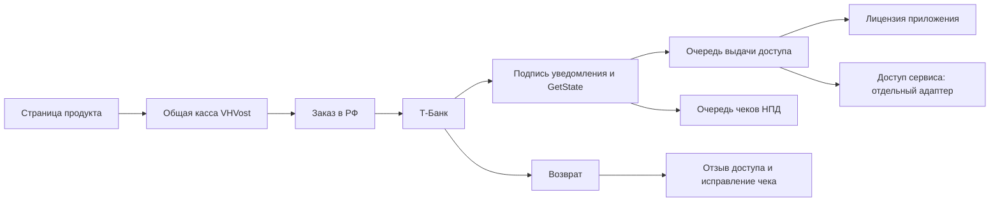

# Единая оплата продуктов VHVost

Решение владельца от 20.10.2026: не подключать новый платёжный процесс заново для каждого продукта.

## Целевой процесс

Публичная точка — `vhvost.com/pay/?product=<id>`. Каталог на сервере задаёт название,
цену в копейках, условия, валюту и тип выдаваемого доступа. Браузер передаёт только ID
продукта, email и ключ повторного запроса. Цена из браузера не принимается.

Один банк, один процесс чеков и поддержки, одна база заказов в РФ. Рабочие базы
Winston и других продуктов остаются самостоятельными. В них передаётся подтверждённое
событие с уникальным ID заказа; повторная доставка не продлевает доступ повторно.
Возврат адресуется тому же продукту и покупателю. Платёж сам по себе не предоставляет
доступа к данным чужого пользователя или организации.

## Реализовано сейчас

- Серверный каталог `commerce/catalog.py`; активен только Shift Switcher Pro 1.x.
- `GET /api/catalog`, `POST /api/checkout` с ID продукта.
- Зафиксированные продукт и цена в заказе, идемпотентность, проверка конфликта продукта.
- Сертификат содержит конкретный продукт; лимит устройств задаётся в каталоге.
- Общая страница `site/pay/`; банковские уведомления, refund и резервирование общие.
- В заказе фиксируются версия условий, политики и момент согласия.
- DEMO-оплата и возврат проверены. LIVE transport развёрнут в РФ; публичная покупка закрыта. Владелец получил закрытый контрольный заказ на 499 ₽ без Bank Init или списания со стороны агента. Настоящая оплата, чек, доставка и возврат пока не подтверждены; другие продукты не включены.
- Существующий Winston не переносился, его тарифы и база не менялись.

Новый продукт с лицензией добавляется записью каталога и настройкой публичного ключа
в клиенте. Для подписок/услуг потребуется адаптер выдачи доступа: создать платёж
недостаточно. Не добавляем фиктивные товары и цены ради демонстрации каталога.

## Что оформить один раз перед LIVE

1. Подтвердить в банке один магазин VHVost для каталога на `vhvost.com/pay/` и допустимые
   виды деятельности. Одного терминала технически достаточно для разных OrderId и
   Description; разрешённый ассортимент и MCC определяет банк. Новая категория товара,
   другое юрлицо или другая модель расчётов может потребовать согласования.
2. Рабочие банковские секреты хранятся вне Git только в закрытой конфигурации РФ-сервера, LIVE/DEMO разделены. Владелец прямо выбрал оставить существующий пароль: смена не выполняется, флаг свежих реквизитов остаётся false, отдельное согласие на существующие реквизиты зафиксировано.
3. Условия каждого продукта, версия согласия в заказе, политика данных и понятный возврат.
4. Один процесс чеков НПД: фактический чек «Мой налог», привязка к заказу и доставка;
   не подставлять выдуманный чек банка и не подключать платную кассу без необходимости.
5. Проверить LIVE контрольную покупку, выдачу, повторный запуск, доставку чека и возврат.

## Обоснование и границы

Повторно подключать магазин на каждый релиз не нужно. Общая касса уменьшает ручную
настройку, но не заменяет согласование банком новой категории товаров. НПД и реквизиты
взяты из HQ; текущая модель — разовые собственные цифровые продукты, без автосписаний.
На этапе запуска достаточно одного процесса и SQLite с транзакциями и шифрованными
проверяемыми резервными копиями. При подключении сервисов добавляется таблица
идемпотентных заданий выдачи, повторы с задержкой и отдельные credentials получателей.
Не объединять балансы/подписки/организации разных продуктов по одному email.

Продажи первого продукта закрыты до настоящей контрольной покупки, чека, доставки
и возврата. Его магазин уже принимает платежи; отсутствие первого проверенного
заказа не заменяем фиктивным CONFIRMED. Для будущих продуктов отдельно ожидается
ответ банка по общей витрине, а не новый технический процесс для каждого релиза.

Поддержка банка: запрос общей витрины отправлен по разрешению владельца в acq_help@tbank.ru.
По обращению № 821787887 команда ответила 20.10.2026 12:20 МСК: изменение
витрины нужно согласовать в чате личного кабинета Т-Бизнес. Запрос передан туда
по разрешению владельца. 26.11 банк подтвердил название магазина VHVost. Изменение
адреса на `https://vhvost.com/pay/` и допустимость следующих собственных приложений
ещё рассматриваются профильным отделом, срок ответа — до 28.11.2026.
Письмо о включении приёма платежей Shift Switcher подтверждено отдельно; оно не доказывает
готовность общей LIVE-кассы.

## Доставка лицензий и чеков

`commerce.delivery` использует общую очередь с уникальной парой заказ/тип письма.
Подтверждённый LIVE-заказ ставит лицензию в очередь; возврат отменяет ожидающую выдачу.
Настоящий чек прикрепляется владельцем через `commerce.operator attach-receipt`,
после чего создаётся отдельное письмо со ссылкой «Мой налог». DEMO не отправляет письма.
SMTP выключен по умолчанию. При неопределённом результате SMTP повтор автоматически
не делается: статус UNCERTAIN требует проверки, чтобы не дублировать письмо.
SENT означает принятие SMTP-сервером, не подтверждение входящих у покупателя.

Для включения рабочей очереди нужны проверенные LIVE-заказ, лицензия и настоящий чек.
Транспорт SMTP проверен отдельным письмом владельцу; подтверждение ниже.

Историческое письмо ACQ_help о передаче вопроса: Gmail `1a1589c6a75dfc3f`. Текущий ответ из чата банка и подтверждение названия сохранены в `docs/evidence/tbank-catalog-clarification-2026-11-26.json`.

Проверено 20.10.2026: владелец разрешил существующий Gmail. Пароль приложения
сохранён только в `/opt/shift-switcher/config/mail.json`, 0600. `smtp_config` подключает
только четыре SMTP-поля и не может включить LIVE или рассылку. Тестовое письмо
на собственный адрес найдено во Входящих (Gmail 1a158dbfcb342cae). Авторассылка
по-прежнему выключена; доставка реальной лицензии и чека проверяется отдельно.
