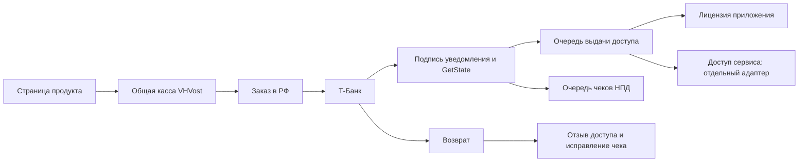

# Единая оплата продуктов VHVost

Решение владельца от 20.10.2026: не подключать новый платёжный процесс заново для каждого продукта.

## Целевой процесс

Публичная точка — `vhvost.com/pay/?product=<id>`. Каталог на сервере задаёт название,
цену в копейках, условия, валюту и тип выдаваемого доступа. Браузер передаёт только ID
продукта, email и ключ повторного запроса. Цена из браузера не принимается.

Один банк, один процесс чеков и поддержки, одна база заказов в РФ. Рабочие базы
Winston и других продуктов остаются самостоятельными. В них передаётся подтверждённое
событие с уникальным ID заказа; повторная доставка не продлевает доступ повторно.
Возврат адресуется тому же продукту и покупателю. Платёж сам по себе не предоставляет
доступа к данным чужого пользователя или организации.

## Реализовано сейчас

- Серверный каталог `commerce/catalog.py`; активен только Shift Switcher Pro 1.x.
- `GET /api/catalog`, `POST /api/checkout` с ID продукта.
- Зафиксированные продукт и цена в заказе, идемпотентность, проверка конфликта продукта.
- Сертификат содержит конкретный продукт; лимит устройств задаётся в каталоге.
- Общая страница `site/pay/`; банковские уведомления, refund и резервирование общие.
- Оплата только DEMO. Общий LIVE транспорт и продажа других продуктов ещё не включены.
- Существующий Winston не переносился, его тарифы и база не менялись.

Новый продукт с лицензией добавляется записью каталога и настройкой публичного ключа
в клиенте. Для подписок/услуг потребуется адаптер выдачи доступа: создать платёж
недостаточно. Не добавляем фиктивные товары и цены ради демонстрации каталога.

## Что оформить один раз перед LIVE

1. Подтвердить в банке один магазин VHVost для каталога на `vhvost.com/pay/` и допустимые
   виды деятельности. Одного терминала технически достаточно для разных OrderId и
   Description; разрешённый ассортимент и MCC определяет банк. Новая категория товара,
   другое юрлицо или другая модель расчётов может потребовать согласования.
2. Свежие банковские секреты вне Git, разделённые LIVE/DEMO. Смена пароля — владельцем.
3. Условия каждого продукта, версия согласия в заказе, политика данных и понятный возврат.
4. Один процесс чеков НПД: фактический чек «Мой налог», привязка к заказу и доставка;
   не подставлять выдуманный чек банка и не подключать платную кассу без необходимости.
5. Проверить LIVE контрольную покупку, выдачу, повторный запуск, доставку чека и возврат.

## Обоснование и границы

Повторно подключать магазин на каждый релиз не нужно. Общая касса уменьшает ручную
настройку, но не заменяет согласование банком новой категории товаров. НПД и реквизиты
взяты из HQ; текущая модель — разовые собственные цифровые продукты, без автосписаний.
На этапе запуска достаточно одного процесса и SQLite с транзакциями и шифрованными
проверяемыми резервными копиями. При подключении сервисов добавляется таблица
идемпотентных заданий выдачи, повторы с задержкой и отдельные credentials получателей.
Не объединять балансы/подписки/организации разных продуктов по одному email.

Блокировка продаж сейчас обусловлена готовностью LIVE и банковской проверкой,
а не необходимостью создавать отдельный банк/магазин при каждом новом продукте.
